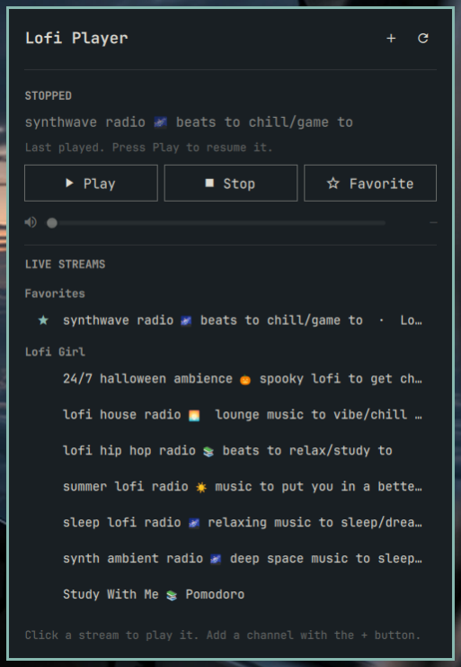

# Lofi player for Omarchy

An Omarchy shell bar widget for [lofi-player](https://github.com/jwkicklighter/lofi-player),
the `lofi` script that streams YouTube live audio through mpv.



- **Left-click** opens the player: play/pause, stop, favorite, volume, and the
  live streams from your channels (favorites first). Click a stream to play it.
  The **+** button opens a field for adding a channel by `@handle`, channel URL,
  or stream URL (it runs `lofi add`).
- **Right-click** plays or pauses (resuming the last stream when stopped).
- **Middle-click** stops.
- **Scroll** changes volume by 5%.

If `lofi` isn't on your PATH (or in `~/.local/bin`), the panel offers setup
instead: check again, copy the install command, or click **Install for me** to
run the installer in a floating terminal. The widget switches to the player as
soon as the script appears.

## Requirements

- Omarchy with the Quattro shell (bar widgets)
- [lofi-player](https://github.com/jwkicklighter/lofi-player), which plays
  streams with `mpv` and `yt-dlp` (and uses `socat`, `jq`, and `curl`). If it's
  missing, the panel can install it for you; the installer is
  `curl -fsSL https://github.com/jwkicklighter/lofi-player/releases/latest/download/install | bash`,
  which installs those dependencies with your package manager (using `sudo`).
  Read the [lofi-player README](https://github.com/jwkicklighter/lofi-player#install)
  first if you'd rather install it yourself.
- `wl-copy` (for the panel's **Copy install command** button; ships with Omarchy)

## Install

From the Omarchy Plugin Marketplace, or with:

```sh
omarchy plugin add https://github.com/jwkicklighter/omarchy-lofi-player --enable
```

To place it yourself, add it without `--enable`, then run
`omarchy plugin enable jwkicklighter.lofi-player --section right`.

Update it with `omarchy plugin update jwkicklighter.lofi-player`.

## Remove

```sh
omarchy plugin disable jwkicklighter.lofi-player
omarchy plugin remove jwkicklighter.lofi-player
```

This removes the widget only. The `lofi` script, its channels, and favorites
are left in place; see the lofi-player README to uninstall those.

Settings (in `~/.config/omarchy/shell.json` on the widget entry, or with
`omarchy bar set jwkicklighter.lofi-player <key> <value>`):

| Key | Default | |
|---|---|---|
| `showVolume` | `false` | Show the volume next to the icon while playing |
| `refreshIntervalSec` | `3` | How often to poll `lofi status` while the panel is closed |

## Development

`LofiModel.js` holds the parsing of `lofi status`, `lofi list`, and
`lofi favorite list`. Test it with:

```sh
node tests/model.test.js
```

Stream titles go to `lofi` as argv elements, never through a shell, and all
text is rendered with `Text.PlainText`.

## Releases

Commits to `master` follow [Conventional Commits](https://www.conventionalcommits.org).
[release-please](https://github.com/googleapis/release-please) keeps a release
PR open that bumps `version.txt`, `manifest.json`, and `CHANGELOG.md`, and
enables auto-merge on it. Merging it tags `vX.Y.Z`, runs the tests at that tag,
and publishes the GitHub release.

Once the plugin is listed in the marketplace, each published release opens a
**Plugin verification** request on
[omacom/omarchy-plugin-marketplace](https://github.com/omacom/omarchy-plugin-marketplace)
for the release commit. A maintainer still has to approve it. This needs:

- the `RELEASE_PLEASE_TOKEN` secret: a token with contents and pull request
  write access to this repo (so release PRs and tags trigger workflows)
- the `MARKETPLACE_TOKEN` secret: a token that can open issues on the
  marketplace repo (a classic token with `public_repo`)
- the `MARKETPLACE_SUBMITTED` repository variable set to `true`, after the
  initial listing is approved

To retry a request, run **Actions → Retry marketplace update** with the tag, or
preview it locally with `python3 tools/marketplace.py --tag vX.Y.Z --dry-run`.
A request is only made when the tag is the current `master` HEAD.

## License

[MIT](LICENSE)
